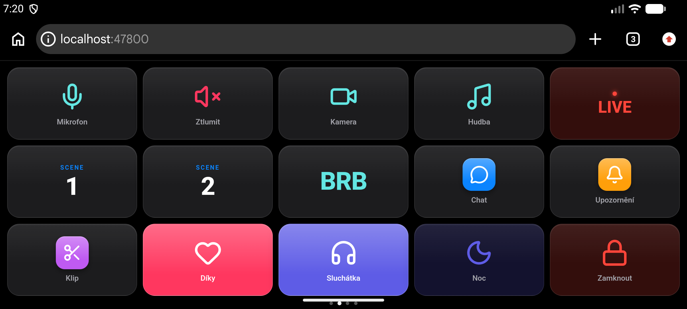
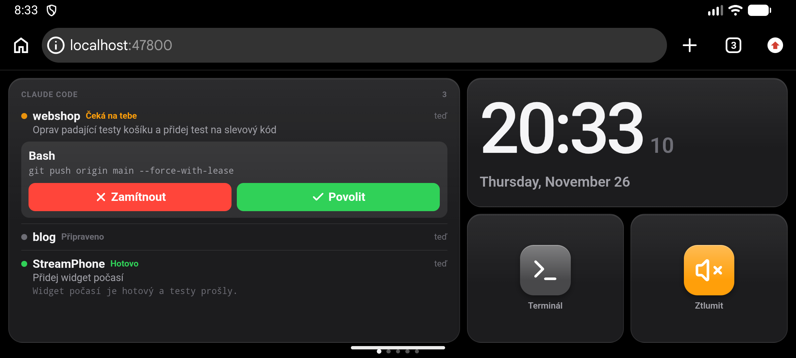

# StreamPhone

Starý Android telefon jako dotykový panel k počítači. Připojuje se USB kabelem nebo přes Wi-Fi a na telefon se nic neinstaluje: dashboard běží v prohlížeči.



Co umí:

- **Tlačítka** jako na stream decku: spouštění programů, klávesové zkratky, ovládání hudby a hlasitosti, zamknutí PC. Čtyři vzhledy, vlastní ikony, textové klávesy.
- **Přehled**: hodiny, přehrávač s obalem alba, vytížení počítače, procesy s možností ukončení, kalendář.
- **Práce**: časovač soustředění a seznam úkolů.
- **AI nástroje**: relace Claude Code, Codexu a dalších, odpověď na žádost o povolení z telefonu, lokální modely v LM Studiu a Ollamě.
- **Discord**: kdo je online na tvých serverech, co hraje a v jakém hlasovém kanálu sedí.
- **Vzhled**: deset motivů, tapety, průhledné karty, vlastní písmo, noční režim.
- **Editor** v prohlížeči na PC: rozložení přetahováním, živý náhled telefonu.



| Počítač | Telefon | Kabelem | Přes Wi-Fi |
|---|---|---|---|
| Windows 10 64bit a novější | Android 8 a novější | ano | ano |
| macOS | Android 8 a novější | ano | ano |

Linux později (agent má pro něj vrstvu `platform`, zatím jen zástupnou).

Stav: raná verze. Vyvíjeno a zkoušeno na Windows 11 s emulátorem Androidu; na skutečném telefonu s Androidem 8 zatím neověřeno. **Podpora macOS je napsaná a přeložená, ale na skutečném Macu nikdy neběžela.** Napojení na Claude Code, Codex, LM Studio, Ollamu a Discord je ověřené proti simulovaným datům.

## Jak to funguje

- `crates/agent` – agent na PC (Rust). Servíruje UI, posílá data přes WebSocket a vykonává akce. Poslouchá jen na `127.0.0.1`.
- `ui` – rozhraní telefonu (Svelte 5 + TypeScript). Při sestavení se vloží do agenta.
- Kabelem: agent sám najde `adb`, a když připojíš telefon, přesměruje mu svůj port (`adb reverse`) a otevře na něm dashboard.
- Přes Wi-Fi: agent nabídne dashboard na adrese počítače v místní síti, jen spárovaným telefonům.

## Spuštění

Potřebuješ Node.js, Rust a Android platform-tools (`adb`).

```powershell
cd ui; npm install; npm run build; cd ..
cargo run
```

Dashboard je pak na `http://localhost:47800/` (na PC i na telefonu připojeném kabelem) a editor vzhledu na `http://localhost:47801/` (jen na PC).

Na telefonu zapni **Možnosti pro vývojáře → Ladění USB** a po připojení potvrď dotaz „Povolit ladění USB“. V Chromu pak přes nabídku **Přidat na plochu** získáš celoobrazovkovou aplikaci.

## Připojení přes Wi-Fi

Ve výchozím stavu agent poslouchá jen na `127.0.0.1` a telefon se k němu dostane pouze kabelem. Wi-Fi se zapíná v editoru v záložce **Připojení** (nebo `"wireless": true` v nastavení):

1. Zapni **Povolit Wi-Fi**. Editor ukáže QR kód.
2. Naskenuj ho fotoaparátem telefonu, který je ve stejné síti. Dashboard se otevře a telefon se spáruje.
3. Přes nabídku prohlížeče **Přidat na plochu** si z něj udělej celoobrazovkovou aplikaci.

Jak je to zabezpečené:

- **Párování**: QR kód nese jednorázový kód (platí 10 minut, po osmi špatných pokusech se zahodí). Telefon ho vymění za vlastní tajemství a to už se po síti neposílá: při každém připojení jím telefon jen podepíše náhodnou výzvu.
- **Bez spárování nic**: nespárované zařízení v síti nedostane nastavení ani data a nemůže mačkat tlačítka.
- **Zrušení**: v záložce Připojení jde telefon odebrat, odpojí se do několika vteřin. Stejně rychle zabere vypnutí Wi-Fi.
- **Jen místní síť**: agent poslouchá pouze na soukromé adrese počítače (192.168.x.x, 10.x.x.x, 172.16–31.x.x), nikdy na veřejné. Editor a příjem událostí z AI nástrojů zůstávají dostupné jen z počítače samotného.
- **Co telefon nesmí**: stejně jako po kabelu může tlačítka jen mačkat. Co tlačítko spustí, jde změnit pouze z PC.
- **Spojení není šifrované.** Ochrání před ostatními zařízeními v domácí síti, ne před někým, kdo dokáže provoz v síti odposlouchávat nebo měnit. Používej ho v síti, které věříš, ne na veřejné Wi-Fi. Obrázky tapet a obalů alb jsou dostupné i bez spárování.

Windows se při prvním zapnutí zeptá, jestli má StreamPhone povolit v síti: povol ho pro **soukromé** sítě. Spárované telefony jsou v `devices.json` vedle nastavení.

Přes Wi-Fi prohlížeč nedovolí stránce držet displej zapnutý běžnou cestou. Dashboard to obchází přehráváním nepatrného tichého videa, které se spustí po prvním dotyku. Kdyby displej přesto zhasínal, zapni na telefonu `Možnosti pro vývojáře → Nevypínat obrazovku` při nabíjení.

## macOS

Agent se na Macu sestaví ze zdrojů (`cd ui; npm install; npm run build; cd ..; cargo build --release`). Hotový program pro Mac zatím ve vydáních není.

| Funkce | Jak je udělaná | Poznámka |
|---|---|---|
| Spouštění | `open` | název aplikace (`"Safari"`), cesta nebo odkaz |
| Klávesové zkratky | AppleScript | `ctrl`, `shift`, `alt` (Option), `win` nebo `cmd` (Command) |
| Přehrávač | AppleScript | Spotify nebo Hudba; bez obalu alba |
| Hlasitost, ztlumení | AppleScript | výstupy bez softwarové hlasitosti (HDMI) nejdou |
| Zamknutí | zkratka Ctrl-Cmd-Q | |
| Vypnutí displeje | `pmset displaysleepnow` | |
| Počítač, procesy, časovač, úkoly, AI, Discord, Wi-Fi | společný kód | |

macOS si při prvním použití vyžádá oprávnění: **Automatizace** pro ovládání Spotify a Hudby a **Zpřístupnění** pro klávesové zkratky a zamknutí (`Nastavení systému → Soukromí a zabezpečení`). Nastavení je v `~/Library/Application Support/StreamPhone/config.json`. Cesty ve výchozích tlačítkách jsou pro Windows, na Macu si je uprav v editoru.

## Nastavení

Stránky, widgety a tlačítka jsou v `%APPDATA%\StreamPhone\config.json` (vytvoří se při prvním spuštění z `crates/agent/default-config.json`). Změny se po uložení souboru projeví na telefonu samy, do vteřiny. Soubor s chybou agent ignoruje a nechá platit předchozí nastavení (chybu vypíše do konzole). Restart je potřeba jen při změně `port`.

Stránka je mřížka 12 × 6, widget má pozici `x`, `y` a velikost `w`, `h`. Typy widgetů: `clock`, `media`, `system`, `deck`, `timer`, `todo`, `processes`, `calendar`, `ai`, `models`, `discord`.

Akce tlačítek (`action.do`):

| Akce | Parametry |
|---|---|
| `launch` | `target` (program, soubor, URL nebo odkaz jako `spotify:`), volitelně `args` |
| `keys` | `combo`, např. `ctrl+shift+esc` |
| `media.play_pause`, `media.next`, `media.prev` | – |
| `audio.mute_toggle`, `audio.set_volume` | `level` 0–1 |
| `system.lock`, `display.off` | – |
| `timer.toggle` | start / pauza časovače; volitelně `focus` a `rest` v minutách |
| `timer.reset`, `timer.skip` | – |

`launch` a `keys` jdou spustit jen z konfigurace na PC. Telefon posílá pouze číslo tlačítka, nikdy příkaz.

## Widgety pro práci

| Widget | Co dělá | `config` |
|---|---|---|
| `timer` | Časovač soustředění: po bloku práce sám spustí přestávku, po přestávce čeká. Na konci každé fáze telefon zavibruje. | `focus` (minuty, výchozí 25), `rest` (výchozí 5) |
| `todo` | Seznam úkolů. Přidáváš a odškrtáváš je na telefonu, ukládají se do `todos.json` vedle nastavení. | `title` |
| `processes` | Programy, které nejvíc vytěžují procesor nebo paměť. Program ukončíš dvěma klepnutími (řádek, pak „Ukončit“). | `sort` (`cpu` nebo `mem`), `kill` (`false` ukončování zakáže) |
| `calendar` | Měsíční kalendář s dnešním dnem. Události zatím neumí. | `weekStart` (`monday` nebo `sunday`) |

Časovač běží v agentovi, takže přežije odpojení telefonu; po restartu agenta začíná znovu. Ukončit jde jen program, který agent právě v seznamu ukazuje, a nikdy systémové procesy Windows ani agent sám.

## AI nástroje na telefonu

Widget `ai` ukazuje běžící relace Claude Code, Codexu a dalších nástrojů (každá má štítek, odkud je): projekt, zadání, co právě dělá a jestli pracuje, čeká na tebe, nebo skončil. Když relace skončí nebo se na něco ptá, telefon zavibruje. Žádost o povolení nástroje jde zodpovědět přímo na telefonu tlačítky **Povolit** a **Zamítnout**.

Claude Code o sobě dává vědět přes hooky. Přidej tohle do `%USERPROFILE%\.claude\settings.json` (sluč s tím, co tam už máš) a spusť Claude Code znovu. Stejný text ti připraví editor, když v záložce Rozložení vybereš widget AI relace.

```json
{
  "hooks": {
    "SessionStart":     [{ "hooks": [{ "type": "http", "url": "http://127.0.0.1:47801/api/hook", "timeout": 5 }] }],
    "UserPromptSubmit": [{ "hooks": [{ "type": "http", "url": "http://127.0.0.1:47801/api/hook", "timeout": 5 }] }],
    "PreToolUse":       [{ "hooks": [{ "type": "http", "url": "http://127.0.0.1:47801/api/hook", "timeout": 5 }] }],
    "PostToolUse":      [{ "hooks": [{ "type": "http", "url": "http://127.0.0.1:47801/api/hook", "timeout": 5 }] }],
    "Notification":     [{ "hooks": [{ "type": "http", "url": "http://127.0.0.1:47801/api/hook", "timeout": 5 }] }],
    "Stop":             [{ "hooks": [{ "type": "http", "url": "http://127.0.0.1:47801/api/hook", "timeout": 5 }] }],
    "SessionEnd":       [{ "hooks": [{ "type": "http", "url": "http://127.0.0.1:47801/api/hook", "timeout": 5 }] }],
    "PermissionRequest": [{ "hooks": [{ "type": "http", "url": "http://127.0.0.1:47801/api/hook", "timeout": 60 }] }]
  }
}
```

Jak funguje Povolit / Zamítnout:

- Žádost o povolení počká na odpověď z telefonu, výchozích 45 sekund (`wait` ve widgetu, 5–300). Po tu dobu se dotaz v okně Claude Code neukáže. Když odpověď nepřijde, zeptá se Claude Code jako obvykle.
- Čeká se jen tehdy, když je widget na některé stránce, má povolené odpovídání a nějaký telefon ho právě zobrazuje. Jinak se Claude Code ptá hned ve svém okně.
- `"approve": false` ve widgetu odpovídání vypne, telefon pak relace jen sleduje. Stejně tak stačí vynechat hook `PermissionRequest`.
- Klepnutím na Povolit pouštíš příkaz na svém počítači, proto telefon ukazuje celý příkaz nebo soubor, o který jde.
- Události přijímá port editoru, který se do telefonu nepřesměrovává. Telefon tedy nemůže relaci ani žádost podvrhnout, jen odpovědět na tu, kterou agent sám zobrazil.
- Když agent neběží, hooky tiše selžou a Claude Code pracuje dál beze změny.

Spotřebu a limity předplatného widget neukazuje, Claude Code je přes hooky neposkytuje.

### Codex

Codex neumí HTTP hooky, spouští program. Agent k tomu má příkaz `hook`, který událost převezme ze standardního vstupu a předá běžícímu agentovi. Ulož jako `%USERPROFILE%\.codex\hooks.json` (cestu k agentovi uprav; přesný text s tvou cestou připraví editor):

```json
{
  "hooks": {
    "SessionStart":     [{ "hooks": [{ "type": "command", "command": "\"C:\\cesta\\streamphone-agent.exe\" hook --source codex", "timeout": 5 }] }],
    "UserPromptSubmit": [{ "hooks": [{ "type": "command", "command": "\"C:\\cesta\\streamphone-agent.exe\" hook --source codex", "timeout": 5 }] }],
    "PreToolUse":       [{ "hooks": [{ "type": "command", "command": "\"C:\\cesta\\streamphone-agent.exe\" hook --source codex", "timeout": 5 }] }],
    "PostToolUse":      [{ "hooks": [{ "type": "command", "command": "\"C:\\cesta\\streamphone-agent.exe\" hook --source codex", "timeout": 5 }] }],
    "Stop":             [{ "hooks": [{ "type": "command", "command": "\"C:\\cesta\\streamphone-agent.exe\" hook --source codex", "timeout": 5 }] }],
    "SessionEnd":       [{ "hooks": [{ "type": "command", "command": "\"C:\\cesta\\streamphone-agent.exe\" hook --source codex", "timeout": 5 }] }]
  }
}
```

Jednodušší varianta, která hlásí jen dokončení odpovědi, je jeden řádek v `%USERPROFILE%\.codex\config.toml`:

```toml
notify = ["C:\\cesta\\streamphone-agent.exe", "report", "--source", "codex"]
```

U Codexu telefon relace jen sleduje. Povolit / Zamítnout funguje pouze pro Claude Code.

### Ostatní nástroje

Cokoli dalšího (Aider, Gemini CLI, Cursor, vlastní skripty) se ohlásí příkazem `report`. Jméno za `--source` si zvolíš sám a ukáže se na telefonu jako štítek:

```powershell
streamphone-agent report --source aider --status working --title "Refaktoring košíku"
```

```powershell
streamphone-agent report --source aider --status done --detail "Hotovo, 3 soubory"
```

| Volba | Význam |
|---|---|
| `--status` | `working`, `waiting` (čeká na tebe), `done`, `idle`, `end` (odebrat z přehledu) |
| `--title`, `--detail` | zadání a řádek pod ním |
| `--session` | rozliší víc relací téhož nástroje; bez ní má nástroj jednu |
| `--cwd` | složka projektu; výchozí je ta, ze které příkaz běží |

Nástroj s hooky, který posílá událost jako JSON na standardní vstup, napojíš přes `streamphone-agent hook --source jmeno`. Agent rozumí názvům událostí Claude Code a Codexu a několika obdobným (`BeforeTool`, `AfterTool`, `beforeShellExecution`, `stop`…).

Oba příkazy vždy skončí úspěšně a mlčí, když agent neběží, takže nástroj, který je volá, nikdy nezdrží ani nerozbijí. Totéž jde poslat i přímo: `POST http://127.0.0.1:47801/api/event` s JSON tělem `{ "source", "status", "title", "detail", "session", "cwd" }`.

### Lokální modely

Widget `models` ukazuje, které lokální servery modelů běží a co mají v paměti:

| Server | Jak se zjišťuje | Co je vidět |
|---|---|---|
| LM Studio (`lmstudio`) | `GET /api/v1/models`, u starších verzí `/api/v0/models` | modely v paměti, kvantizace, velikost, počet na disku |
| Ollama (`ollama`) | `GET /api/ps` a `/api/tags` | modely v paměti, kvantizace, velikost, počet na disku |
| cokoli kompatibilního s OpenAI (`openai`) | `GET /v1/models` | nabízené modely |

Bez nastavení sleduje LM Studio na `http://127.0.0.1:1234` a Ollamu na `http://127.0.0.1:11434`. Další servery (llama.cpp, Jan, KoboldCpp, LocalAI, vLLM, text-generation-webui) přidáš v editoru nebo ručně:

```json
{ "id": "ai-models", "type": "models", "x": 7, "y": 0, "w": 5, "h": 6,
  "config": { "hideOffline": false, "servers": [
    { "name": "LM Studio", "url": "http://127.0.0.1:1234", "kind": "lmstudio" },
    { "name": "llama.cpp", "url": "http://127.0.0.1:8080", "kind": "openai" } ] } }
```

Jen adresy `http://`, bez přihlašování. Pokud máš v LM Studiu zapnuté tokeny, widget ho uvidí jako vypnuté. Načítat a uvolňovat modely z telefonu zatím nejde.

## Discord

Widget `discord` ukazuje, kdo je online na vybraných serverech: stav (online, nepřítomen, nerušit), co kdo hraje a v jakém hlasovém kanálu sedí. Přátele, které vyjmenuješ, řadí nahoru, zvýrazní je a zavibruje, když některý přijde.

Discord cizím aplikacím seznam přátel nevydává (je vyhrazený schváleným partnerům) a přihlášení osobním tokenem porušuje jeho podmínky. Widget proto čte veřejný **widget serveru**, který nevyžaduje žádné přihlášení:

1. Správce serveru zapne `Nastavení serveru → Widget → Povolit widget serveru`.
2. Na stejné stránce je **ID serveru**. To zadej do widgetu (v editoru, nebo ručně).

```json
{ "id": "social-discord", "type": "discord", "x": 0, "y": 0, "w": 4, "h": 6,
  "config": { "servers": ["290926798626999250"], "friends": ["adam", "Zuzka"], "onlyFriends": false, "notify": true } }
```

| Volba | Význam |
|---|---|
| `servers` | až pět ID serverů |
| `friends` | jména tak, jak je Discord na serveru ukazuje (na velikosti písmen nezáleží) |
| `onlyFriends` | ukázat jen vyjmenované přátele |
| `notify` | zavibrovat, když přítel přijde online (výchozí ano) |

Omezení daná Discordem: funguje jen pro servery se zapnutým widgetem, seznam má nejvýš 100 lidí, obnovuje se zhruba po minutě a neukazuje lidi offline ani ty, kdo se skrývají. Agent se na Discord ptá jen tehdy, když je widget na telefonu vidět, a to jednou za 30 sekund. K tomu potřebuje PC připojení k internetu; telefon ne, obrázky profilů mu předává agent.

Ztlumení mikrofonu a sluchátek v Discordu ovládneš tlačítkem s akcí `keys`: v Discordu si v `Nastavení → Klávesové zkratky` nastav zkratku a tutéž dej tlačítku.

## Noční režim

```json
"night": { "enabled": true, "from": "22:00", "to": "07:00", "dim": 0.5, "red": true, "page": "clock" }
```

V daném čase dashboard ztmavne (`dim` 0–1), s `red` svítí jen červeně a s `page` se při setmění přepne na zvolenou stránku.

## Editor

Na `http://localhost:47801/` je editor s živým náhledem telefonu: rozložení (widgety se přetahují přímo v náhledu, velikost se mění tažením za roh, jdou přidávat a mazat, stejně jako stránky), motivy, barvy, karty, tapety (včetně nahrání obrázku), písmo, vzhled jednotlivých stránek, tlačítka (ikona, barva, text, akce, pořadí) a noční režim. Změny se ukládají samy a na telefonu se projeví hned.

Editor běží na vlastním portu, který se do telefonu nepřesměrovává. Telefon tak může tlačítka jen mačkat; co tlačítko spustí, jde změnit pouze z PC. Před prvním zásahem editor uloží původní nastavení jako `config.backup.json`.

Vše, co editor umí, jde nastavit i ručně v `config.json`, jak popisuje zbytek této části.

## Vzhled

Vlastní obrázky a písma patří do složky `%APPDATA%\StreamPhone\assets` (vytvoří se sama). V nastavení se na ně odkazuješ jen názvem souboru, např. `"wall.jpg"` nebo `"ikony/obs.png"`.

### Motiv

`theme` je buď název motivu, nebo objekt, který z některého motivu vychází a mění, co potřebuješ:

```json
"theme": {
  "preset": "glass",
  "colors": { "accent": "#ffd166" },
  "background": { "image": "wall.jpg", "fit": "cover", "dim": 0.25, "blur": 0 },
  "card": { "opacity": 0.45, "blur": 2.5, "radius": 3.4, "border": true },
  "font": { "family": "Georgia", "file": "MojePismo.ttf" },
  "gap": 2
}
```

Vestavěné motivy: `midnight` (výchozí), `graphite`, `ocean`, `forest`, `sunset`, `rose`, `paper` (světlý), `terminal`, `neon`, `glass`.

| Část | Položky |
|---|---|
| `colors` | `bg`, `card`, `cardHi`, `line`, `text`, `dim`, `mute`, `accent`, `ok`, `warn`, `bad` |
| `background` | `image` (soubor nebo URL), `fit` (`cover`, `contain`, `stretch`, `tile`), `dim` 0–1 (ztmavení), `blur` (rozostření), `fill` (barva nebo CSS přechod) |
| `card` | `opacity` 0–1 (průhlednost karet), `blur` (matné sklo pod kartou), `radius` (zaoblení, 0 = hranaté), `border`, `depth` (lesk a stín) |
| `font` | `family` (písmo v telefonu), `file` (soubor `.ttf`, `.otf`, `.woff`, `.woff2`) |
| `gap` | mezera mezi widgety |

Vlastní pojmenované motivy si ulož do `themes` a používej je názvem:

```json
"themes": { "moje": { "preset": "neon", "card": { "radius": 1 }, "gap": 3 } },
"theme": "moje"
```

### Stránka

Stránka může mít vlastní motiv (`"theme": "paper"`, nahradí globální celý) a vlastní tapetu (`"background": "hory.jpg"` nebo objekt jako výše; `null` tapetu vypne). `"dots": false` v kořeni nastavení skryje tečky stránek.

### Widget

Každý widget může mít `style`:

```json
{ "id": "home-system", "type": "system", "x": 9, "y": 0, "w": 3, "h": 4,
  "style": { "background": "#000000", "opacity": 0.75, "accent": "#ff6fa3", "text": "#ffffff", "radius": 1, "border": false } }
```

Hodiny (`config`): `format` (`"24h"` nebo `"12h"`), `seconds`, `date`, `size`, `weight` (100–900), `color`, `font`, `align` (`left`, `center`, `right`).

Přehrávač (`config`): `artBackground` (`false` vypne obarvení karty rozmazaným obalem alba). Počítač (`config`): `graph` (`false` skryje graf).

Deck (`config`): `cols`, `labels` (`false` skryje popisky), `iconSize`, `look`.

Tlačítko:

| Položka | Význam |
|---|---|
| `label` | popisek pod ikonou |
| `icon` | název ikony (seznam je v editoru nebo v `ui/src/lib/icons.ts`) |
| `image` | vlastní obrázek místo ikony |
| `text` | velký text místo ikony, např. `"BRB"` nebo `"1"` |
| `caption` | malý nadpisek nad textem, např. `"SCENE"` |
| `dot` | barevná tečka nad textem (např. `"red"` u `LIVE`) |
| `color` | barva ikony nebo textu |
| `look` | `icon` (barevná dlaždice s bílým symbolem), `glyph` (jen symbol), `tinted` (tónované), `filled` (celé barevné) |
| `background`, `labelColor` | barva tlačítka a popisku |

Barvy jde všude psát kódem (`#ff453a`) nebo jménem: `red`, `orange`, `yellow`, `green`, `mint`, `teal`, `cyan`, `blue`, `indigo`, `purple`, `pink`, `brown`, `gray`, `graphite`, `white`, `black`.

```json
{ "label": "", "caption": "SCENE", "text": "1", "color": "white", "action": { "do": "keys", "combo": "ctrl+alt+1" } },
{ "label": "", "text": "LIVE", "dot": "red", "look": "tinted", "color": "red", "action": { "do": "keys", "combo": "ctrl+alt+l" } }
```

## Vývoj

```powershell
cargo run            # agent
cd ui; npm run dev   # UI s hot reloadem, /ws se přeposílá na agenta
cargo test
```

Agent do sebe vkládá sestavené UI ze složky `ui/dist`, takže před prvním `cargo build` musí proběhnout `npm run build`.

Šifrované spojení pro Discord potřebuje kompilátor C. Kde není, sestav agenta bez něj (`cargo build --no-default-features`); widget Discord pak hlásí, že Discord není dostupný.

## Licence

[MIT](LICENSE)
