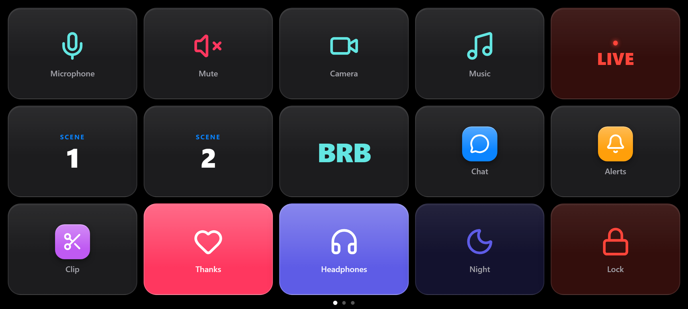
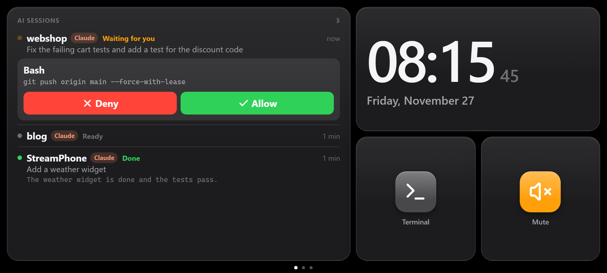
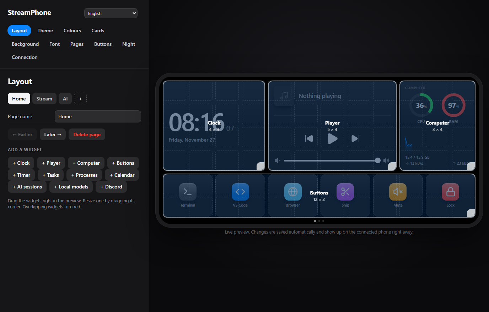
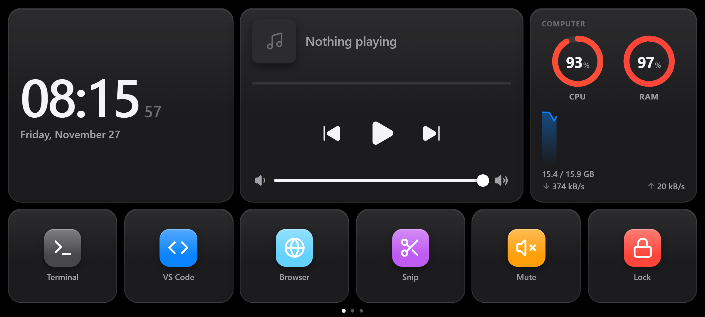

# StreamPhone

**English** · [Česky](README.cs.md)

An old Android phone as a touch panel for your computer. It connects with a USB cable or over Wi-Fi. A desktop app with an editor runs on the computer; the phone runs the StreamPhone app, or just a browser.



What it does:

- **Buttons** like a stream deck: open programs, press key combinations, control music and volume, lock the PC. Four looks, your own icons, text keys.
- **Overview**: clock, media player with album art, system load, processes you can end, calendar.
- **Work**: focus timer and to-do list.
- **AI tools**: sessions of Claude Code, Codex and others, answering a permission request from the phone, local models in LM Studio and Ollama.
- **Discord**: who is online on your servers, what they play and which voice channel they are in.
- **Look**: ten themes, wallpapers, see-through cards, your own font, night mode.
- **Editor** on the PC: drag-and-drop layout with a live preview of the phone.
- **Languages**: English, Czech, Slovak, German, Polish, Spanish and French.



| Computer | Phone | Cable | Wi-Fi |
|---|---|---|---|
| Windows 10 64-bit or newer | Android 8 or newer | yes | yes |
| macOS | Android 8 or newer | yes | yes |
| Windows, macOS | iPhone (in Safari; an app comes later) | no | yes |

Linux later (the agent has a `platform` layer for it, a stub so far).

Status: an early version. Developed and tried on Windows 11 with an Android emulator; not yet verified on a real phone running Android 8. **macOS support is written and compiles, but has never run on a real Mac.** The Claude Code, Codex, LM Studio, Ollama and Discord integrations are verified against simulated data.

## Install

**Computer (Windows):** download `StreamPhone_x.y.z_x64-setup.exe` from the [releases](https://github.com/opdev-271/StreamPhone/releases) and install it. The app opens a window with the editor and settles in the notification area, where it keeps running after the window is closed. The installer is not code-signed, so Windows SmartScreen may ask before running it.

**Phone (Android 8 or newer):** install `StreamPhone-x.y.z.apk` from the same release (the phone asks to allow installing from this source). It also works without the app: the dashboard opens in the browser.

**Connect them over Wi-Fi (recommended):** in the Windows app open **Connection**, turn on **Allow Wi-Fi** and scan the QR code with the phone. Nothing has to be set up on the phone and nothing plugged in; details are in [Connecting over Wi-Fi](#connecting-over-wi-fi).

**Or by cable**, for places without Wi-Fi: turn on USB debugging on the phone and plug it in. For this the computer needs `adb` from the [Android platform-tools](https://developer.android.com/tools/releases/platform-tools); putting `adb.exe` and its two libraries into the folder StreamPhone was installed to is enough. Wi-Fi needs no `adb`.

### The Windows app



- **The window** is the editor: layout, look, buttons, connection, all with a live preview of the phone.
- **Closing the window** does not quit the app; the phone keeps working. Quit from the icon in the notification area.
- **Start with the system** is switched on in the same icon's menu.
- The install also contains `streamphone-agent.exe` for the command line (hooks of AI tools, running without a window).

### The Android app



- **Full screen**, no browser bars, and the display stays on.
- **Finds the computer by itself**: first over the cable, then at the Wi-Fi address it is paired with.
- **Pairing**: scan the QR code from the editor (Connection tab), or type the address and the code.
- **Volume keys** turn the pages.
- **Back** opens the connection screen (another computer, forgetting the Wi-Fi).
- When the app is installed, the agent opens it instead of the browser once the cable is plugged in.

## Languages

The dashboard, the editor, the Android app, the tray menu and the installer speak English, Czech, Slovak, German, Polish, Spanish and French.

- **By default** each device uses its own language (the phone its system language, the editor the browser's), otherwise English.
- **One language for everything**: pick it in the editor next to the title, or set `"language": "de"` in the config (`"auto"` restores the default).
- **A fresh install** names the default pages and buttons in the system's language. Names you type yourself are not translated.
- The Android app follows the phone's language (its connection screen); the dashboard inside follows the setting above.

Translations live in `ui/src/lib/strings.ts`, `ui/src/editor/strings.ts`, `crates/agent/src/lang.rs` and `android/app/src/main/res/values-*`. The texts in the code are Czech and double as lookup keys; a missing translation falls back to English.

## How it works

- `crates/agent` – the agent on the PC (Rust). Serves the UI, sends data over a WebSocket and carries out actions. Listens on `127.0.0.1` only.
- `crates/app` – the Windows app (Tauri): the agent in a window, a tray icon, an installer.
- `android` – the Android app (Java, WebView).
- `ui` – the phone's interface and the editor (Svelte 5 + TypeScript). Embedded into the agent at build time.
- Cable: the agent finds `adb` itself and, when a phone is plugged in, forwards its port to it (`adb reverse`) and opens the dashboard there.
- Wi-Fi: the agent offers the dashboard at the computer's address on the local network, to paired phones only.

## Running from source

You need Node.js, Rust and the Android platform-tools (`adb`).

```powershell
cd ui; npm install; npm run build; cd ..
cargo run -p streamphone-agent
```

The dashboard is then at `http://localhost:47800/` (on the PC and on a phone connected by cable) and the editor at `http://localhost:47801/` (PC only).

On the phone, turn on **Developer options → USB debugging** and confirm the "Allow USB debugging" prompt after plugging in. In Chrome, **Add to Home screen** then gives you a full-screen app.

## Connecting over Wi-Fi

**Android:** scan the QR code in the StreamPhone app. **iPhone:** scan it with the camera; the dashboard opens in Safari. *Share → Add to Home Screen* then gives a full-screen app; iOS keeps its storage apart from Safari's, so it pairs separately: type the code shown under the QR code. Any phone can pair that way. An iPhone on plain http cannot be kept awake by the page, so set *Settings → Display & Brightness → Auto-Lock → Never* while it serves as a panel. **The iPhone path has not been tried on a real iPhone yet.**

By default the agent listens on `127.0.0.1` only and the phone reaches it through the cable alone. Wi-Fi is switched on in the editor's **Connection** tab (or `"wireless": true` in the config):

1. Turn on **Allow Wi-Fi**. The editor shows a QR code.
2. Scan it with a phone on the same network. The dashboard opens and the phone is paired.
3. Use the browser's **Add to Home screen** to make it a full-screen app (or use the Android app).

How it is secured:

- **Pairing**: the QR code carries a one-time code (valid for 10 minutes, thrown away after eight wrong guesses). The phone trades it for a secret of its own, which is not sent over the network again: on every connection the phone only signs a random challenge with it.
- **Nothing without pairing**: an unpaired device on the network gets neither the settings nor the data, and cannot press buttons.
- **Revoking**: a phone can be removed in the Connection tab and is disconnected within seconds. Switching Wi-Fi off works just as fast.
- **Local network only**: the agent listens on the computer's private address (192.168.x.x, 10.x.x.x, 172.16–31.x.x), never on a public one. The editor and the endpoint for AI tools stay reachable from the computer itself only.
- **What a phone may not do**: as over the cable, it can only press buttons. What a button launches can be changed from the PC alone.
- **The connection is not encrypted.** It keeps out other devices on a home network, not somebody who can listen to or tamper with the network's traffic. Use it on a network you trust, not on public Wi-Fi. Wallpaper pictures and album covers are reachable without pairing.

The first time, Windows asks whether to allow StreamPhone on the network: allow it for **private** networks. Paired phones are kept in `devices.json` next to the config.

Over Wi-Fi a browser does not let a page keep the display on the usual way. The dashboard works around it by playing a tiny silent video, started by the first touch. If the display still turns off, enable `Developer options → Stay awake` on the phone (the Android app does not need any of this).

## macOS

On a Mac the agent is built from source (`cd ui; npm install; npm run build; cd ..; cargo build --release -p streamphone-agent`). There is no ready-made Mac program in the releases yet.

| Feature | How it is done | Note |
|---|---|---|
| Launching | `open` | an app's name (`"Safari"`), a path or a link |
| Key combinations | AppleScript | `ctrl`, `shift`, `alt` (Option), `win` or `cmd` (Command) |
| Media player | AppleScript | Spotify or Music; no album art |
| Volume, mute | AppleScript | outputs without software volume (HDMI) cannot be set |
| Lock | the Ctrl-Cmd-Q shortcut | |
| Display off | `pmset displaysleepnow` | |
| System load, processes, timer, to-do, AI, Discord, Wi-Fi | shared code | |

macOS asks for permissions on first use: **Automation** to control Spotify and Music, and **Accessibility** for key combinations and locking (`System Settings → Privacy & Security`). The config is at `~/Library/Application Support/StreamPhone/config.json`. The paths in the default buttons are for Windows; change them in the editor.

## Configuration

Pages, widgets and buttons live in `%APPDATA%\StreamPhone\config.json` (created on first start from `crates/agent/default-config.json`). Saved changes show up on the phone by themselves within a second. A file with a mistake is ignored and the previous config stays in effect (the error is printed to the console). Only a changed `port` needs a restart.

A page is a 12 × 6 grid; a widget has a position `x`, `y` and a size `w`, `h`. Widget types: `clock`, `media`, `system`, `deck`, `timer`, `todo`, `processes`, `calendar`, `ai`, `models`, `discord`.

Button actions (`action.do`):

| Action | Parameters |
|---|---|
| `launch` | `target` (a program, file, URL or a link such as `spotify:`), optionally `args` |
| `keys` | `combo`, e.g. `ctrl+shift+esc` |
| `media.play_pause`, `media.next`, `media.prev` | – |
| `audio.mute_toggle`, `audio.set_volume` | `level` 0–1 |
| `system.lock`, `display.off` | – |
| `timer.toggle` | starts / pauses the timer; optionally `focus` and `rest` in minutes |
| `timer.reset`, `timer.skip` | – |

`launch` and `keys` can only come from the config on the PC. The phone sends the number of a button, never a command.

## Work widgets

| Widget | What it does | `config` |
|---|---|---|
| `timer` | Focus timer: after a block of work it starts the break by itself; after the break it waits. The phone buzzes at the end of each phase. | `focus` (minutes, default 25), `rest` (default 5) |
| `todo` | To-do list. You add and tick tasks on the phone; they are stored in `todos.json` next to the config. | `title` |
| `processes` | The programs using the most CPU or memory. End one with two taps (the row, then "End"). | `sort` (`cpu` or `mem`), `kill` (`false` forbids ending) |
| `calendar` | A month calendar with today marked. No events yet. | `weekStart` (`monday` or `sunday`) |

The timer runs in the agent, so it survives the phone disconnecting; it starts over when the agent restarts. Only a program the agent currently lists can be ended, and never system processes or the agent itself.

## AI tools on the phone

The `ai` widget shows running sessions of Claude Code, Codex and other tools (each tagged with where it comes from): the project, the prompt, what it is doing and whether it works, waits for you or has finished. The phone buzzes when a session finishes or asks something. A tool permission request can be answered right on the phone with **Allow** and **Deny**.

Claude Code reports through hooks. Add this to `%USERPROFILE%\.claude\settings.json` (merge it with what is already there) and restart Claude Code. The editor prepares the same text when you select the AI sessions widget in the Layout tab.

```json
{
  "hooks": {
    "SessionStart":     [{ "hooks": [{ "type": "http", "url": "http://127.0.0.1:47801/api/hook", "timeout": 5 }] }],
    "UserPromptSubmit": [{ "hooks": [{ "type": "http", "url": "http://127.0.0.1:47801/api/hook", "timeout": 5 }] }],
    "PreToolUse":       [{ "hooks": [{ "type": "http", "url": "http://127.0.0.1:47801/api/hook", "timeout": 5 }] }],
    "PostToolUse":      [{ "hooks": [{ "type": "http", "url": "http://127.0.0.1:47801/api/hook", "timeout": 5 }] }],
    "Notification":     [{ "hooks": [{ "type": "http", "url": "http://127.0.0.1:47801/api/hook", "timeout": 5 }] }],
    "Stop":             [{ "hooks": [{ "type": "http", "url": "http://127.0.0.1:47801/api/hook", "timeout": 5 }] }],
    "SessionEnd":       [{ "hooks": [{ "type": "http", "url": "http://127.0.0.1:47801/api/hook", "timeout": 5 }] }],
    "PermissionRequest": [{ "hooks": [{ "type": "http", "url": "http://127.0.0.1:47801/api/hook", "timeout": 60 }] }]
  }
}
```

How Allow / Deny works:

- A permission request waits for an answer from the phone, 45 seconds by default (`wait` on the widget, 5–300). Meanwhile the question does not appear in Claude Code's window. If no answer comes, Claude Code asks as usual.
- It only waits when the widget is on some page, has answering enabled and a phone is showing it right now. Otherwise Claude Code asks in its own window at once.
- `"approve": false` on the widget turns answering off; the phone then only watches. Leaving out the `PermissionRequest` hook does the same.
- Tapping Allow runs a command on your computer, which is why the phone shows the whole command or file in question.
- Events are received on the editor's port, which is never forwarded to the phone. A phone therefore cannot fake a session or a request; it can only answer one the agent itself has shown.
- When the agent is not running, the hooks fail quietly and Claude Code works on unchanged.

The widget does not show usage or subscription limits; Claude Code does not provide them through hooks.

### Codex

Codex has no HTTP hooks; it runs a program. The agent has a `hook` command for that, which takes the event from standard input and passes it to the running agent. Save as `%USERPROFILE%\.codex\hooks.json` (adjust the path to the agent; the editor prepares the exact text with your path):

```json
{
  "hooks": {
    "SessionStart":     [{ "hooks": [{ "type": "command", "command": "\"C:\\path\\streamphone-agent.exe\" hook --source codex", "timeout": 5 }] }],
    "UserPromptSubmit": [{ "hooks": [{ "type": "command", "command": "\"C:\\path\\streamphone-agent.exe\" hook --source codex", "timeout": 5 }] }],
    "PreToolUse":       [{ "hooks": [{ "type": "command", "command": "\"C:\\path\\streamphone-agent.exe\" hook --source codex", "timeout": 5 }] }],
    "PostToolUse":      [{ "hooks": [{ "type": "command", "command": "\"C:\\path\\streamphone-agent.exe\" hook --source codex", "timeout": 5 }] }],
    "Stop":             [{ "hooks": [{ "type": "command", "command": "\"C:\\path\\streamphone-agent.exe\" hook --source codex", "timeout": 5 }] }],
    "SessionEnd":       [{ "hooks": [{ "type": "command", "command": "\"C:\\path\\streamphone-agent.exe\" hook --source codex", "timeout": 5 }] }]
  }
}
```

A simpler variant that only reports a finished answer is one line in `%USERPROFILE%\.codex\config.toml`:

```toml
notify = ["C:\\path\\streamphone-agent.exe", "report", "--source", "codex"]
```

With Codex the phone only watches the sessions. Allow / Deny works for Claude Code only.

### Other tools

Anything else (Aider, Gemini CLI, Cursor, your own scripts) reports with the `report` command. You choose the name after `--source`; the phone shows it as a tag:

```powershell
streamphone-agent report --source aider --status working --title "Refactoring the cart"
```

```powershell
streamphone-agent report --source aider --status done --detail "Done, 3 files"
```

| Option | Meaning |
|---|---|
| `--status` | `working`, `waiting` (for you), `done`, `idle`, `end` (remove from the list) |
| `--title`, `--detail` | the prompt and the line under it |
| `--session` | tells several sessions of one tool apart; without it a tool has one |
| `--cwd` | the project folder; defaults to where the command runs |

A tool with hooks that sends the event as JSON on standard input connects through `streamphone-agent hook --source name`. The agent understands the event names of Claude Code and Codex and a few similar ones (`BeforeTool`, `AfterTool`, `beforeShellExecution`, `stop`…).

Both commands always exit successfully and stay silent when the agent is not running, so a tool calling them is never held up or broken. The same can be sent directly: `POST http://127.0.0.1:47801/api/event` with a JSON body `{ "source", "status", "title", "detail", "session", "cwd" }`.

### Local models

The `models` widget shows which local model servers are running and what they have in memory:

| Server | How it is asked | What you see |
|---|---|---|
| LM Studio (`lmstudio`) | `GET /api/v1/models`, older versions `/api/v0/models` | loaded models, quantization, size, number on disk |
| Ollama (`ollama`) | `GET /api/ps` and `/api/tags` | loaded models, quantization, size, number on disk |
| anything OpenAI-compatible (`openai`) | `GET /v1/models` | the models on offer |

Without any setting it watches LM Studio at `http://127.0.0.1:1234` and Ollama at `http://127.0.0.1:11434`. Add other servers (llama.cpp, Jan, KoboldCpp, LocalAI, vLLM, text-generation-webui) in the editor or by hand:

```json
{ "id": "ai-models", "type": "models", "x": 7, "y": 0, "w": 5, "h": 6,
  "config": { "hideOffline": false, "servers": [
    { "name": "LM Studio", "url": "http://127.0.0.1:1234", "kind": "lmstudio" },
    { "name": "llama.cpp", "url": "http://127.0.0.1:8080", "kind": "openai" } ] } }
```

`http://` addresses only, no authentication. If tokens are enabled in LM Studio, the widget sees it as stopped. Loading and unloading models from the phone is not possible yet.

## Discord

The `discord` widget shows who is online on chosen servers: status (online, idle, do not disturb), what they play and which voice channel they are in. Friends you list are sorted first and highlighted, and the phone buzzes when one comes online.

Discord does not give other apps your friends list (it is reserved for approved partners), and signing in with a personal token breaks its terms. The widget therefore reads the public **server widget**, which needs no login:

1. A server admin turns on `Server Settings → Widget → Enable Server Widget`.
2. The **Server ID** is on the same page. Enter it in the widget (in the editor, or by hand).

```json
{ "id": "social-discord", "type": "discord", "x": 0, "y": 0, "w": 4, "h": 6,
  "config": { "servers": ["290926798626999250"], "friends": ["adam", "Zuzka"], "onlyFriends": false, "notify": true } }
```

| Option | Meaning |
|---|---|
| `servers` | up to five server IDs |
| `friends` | names as Discord shows them on the server (case does not matter) |
| `onlyFriends` | show only the listed friends |
| `notify` | buzz when a friend comes online (on by default) |

Limits set by Discord: it works only for servers with the widget enabled, lists at most 100 people, refreshes about once a minute and shows neither offline people nor those who appear offline. The agent asks Discord only while the widget is visible on a phone, once every 30 seconds. The PC needs an internet connection for that; the phone does not, as the agent passes the profile pictures on.

Muting the microphone or headphones in Discord works with a button using the `keys` action: set a shortcut under `Settings → Keybinds` in Discord and give the button the same one.

## Night mode

```json
"night": { "enabled": true, "from": "22:00", "to": "07:00", "dim": 0.5, "red": true, "page": "clock" }
```

During these hours the dashboard dims (`dim` 0–1), with `red` it shows red light only, and with `page` it turns to the chosen page when the night starts.

## Editor

**Ready-made pages:** the **+** next to the pages opens a gallery with pages for video editing (Premiere Pro, DaVinci Resolve), After Effects, streaming, coding, Teams meetings, music, gaming and a computer overview. A page added from it is an ordinary page, so every key and widget on it can be changed. The shortcuts are the programs' Windows defaults; the stream page presses F13–F24, which you assign to actions in OBS or Streamlabs yourself.

`http://localhost:47801/` (or the window of the Windows app) is the editor with a live preview of the phone: layout (drag widgets right in the preview, resize by the corner, add and delete them and pages), themes, colours, cards, wallpapers (with picture upload), font, the look of single pages, buttons (icon, colour, text, action, order), night mode, connection and language. Changes are saved automatically and show up on the phone right away.

The editor runs on a port of its own that is never forwarded to the phone. The phone can therefore only press buttons; what a button launches can be changed from the PC alone. Before its first change the editor saves the original config as `config.backup.json`.

Everything the editor does can also be set by hand in `config.json`, as the rest of this part describes.

## Look

Your own pictures and fonts go into `%APPDATA%\StreamPhone\assets` (created automatically). In the config you refer to them by file name only, e.g. `"wall.jpg"` or `"icons/obs.png"`.

### Theme

`theme` is either a theme's name or an object that starts from a theme and changes what you need:

```json
"theme": {
  "preset": "glass",
  "colors": { "accent": "#ffd166" },
  "background": { "image": "wall.jpg", "fit": "cover", "dim": 0.25, "blur": 0 },
  "card": { "opacity": 0.45, "blur": 2.5, "radius": 3.4, "border": true },
  "font": { "family": "Georgia", "file": "MyFont.ttf" },
  "gap": 2
}
```

Built-in themes: `midnight` (default), `graphite`, `ocean`, `forest`, `sunset`, `rose`, `paper` (light), `terminal`, `neon`, `cyber`, `redteam`, `blueteam` (the three security looks: square panels, a monospaced face, a grid behind them), `glass`.

| Part | Items |
|---|---|
| `colors` | `bg`, `card`, `cardHi`, `line`, `text`, `dim`, `mute`, `accent`, `ok`, `warn`, `bad` |
| `background` | `image` (a file or URL), `fit` (`cover`, `contain`, `stretch`, `tile`), `dim` 0–1, `blur`, `fill` (a colour or CSS gradient) |
| `card` | `opacity` 0–1, `blur` (frosted glass under the card), `radius` (0 = square), `border`, `depth` (sheen and shadow) |
| `font` | `family` (a font on the phone), `file` (a `.ttf`, `.otf`, `.woff` or `.woff2` file) |
| `gap` | the space between widgets |

Save your own named themes under `themes` and use them by name:

```json
"themes": { "mine": { "preset": "neon", "card": { "radius": 1 }, "gap": 3 } },
"theme": "mine"
```

### Page

A page can have its own theme (`"theme": "paper"`, which replaces the global one entirely) and its own wallpaper (`"background": "hills.jpg"` or an object as above; `null` turns the wallpaper off). `"dots": false` at the root of the config hides the page dots.

### Widget

Every widget can have a `style`:

```json
{ "id": "home-system", "type": "system", "x": 9, "y": 0, "w": 3, "h": 4,
  "style": { "background": "#000000", "opacity": 0.75, "accent": "#ff6fa3", "text": "#ffffff", "radius": 1, "border": false } }
```

Clock (`config`): `format` (`"24h"` or `"12h"`), `seconds`, `date`, `size`, `weight` (100–900), `color`, `font`, `align` (`left`, `center`, `right`).

Media player (`config`): `artBackground` (`false` stops tinting the card with the blurred album cover). System (`config`): `graph` (`false` hides the graph).

Deck (`config`): `cols`, `labels` (`false` hides the labels), `iconSize`, `look`.

A button:

| Item | Meaning |
|---|---|
| `label` | the text under the icon |
| `icon` | an icon's name (listed in the editor, or in `ui/src/lib/icons.ts`) |
| `image` | your own picture instead of the icon |
| `text` | big text instead of an icon, e.g. `"BRB"` or `"1"` |
| `caption` | a small line above the text, e.g. `"SCENE"` |
| `dot` | a coloured dot above the text (e.g. `"red"` for `LIVE`) |
| `color` | the colour of the icon or text |
| `look` | `icon` (a coloured tile with a white symbol), `glyph` (the symbol only), `tinted`, `filled` (the whole key coloured) |
| `background`, `labelColor` | the colour of the key and of its label |

Colours can be written as a code (`#ff453a`) or by name anywhere: `red`, `orange`, `yellow`, `green`, `mint`, `teal`, `cyan`, `blue`, `indigo`, `purple`, `pink`, `brown`, `gray`, `graphite`, `white`, `black`.

```json
{ "label": "", "caption": "SCENE", "text": "1", "color": "white", "action": { "do": "keys", "combo": "ctrl+alt+1" } },
{ "label": "", "text": "LIVE", "dot": "red", "look": "tinted", "color": "red", "action": { "do": "keys", "combo": "ctrl+alt+l" } }
```

## Development

```powershell
cargo run -p streamphone-agent   # the agent
cd ui; npm run dev               # the UI with hot reload; /ws is proxied to the agent
cargo test
```

The agent embeds the built UI from `ui/dist`, so `npm run build` has to run before the first `cargo build`.

The Windows installer (the result is in `target/release/bundle/nsis`):

```powershell
cargo build --release -p streamphone-agent
Copy-Item target/release/streamphone-agent.exe crates/app/bin/streamphone-agent-x86_64-pc-windows-msvc.exe
cd crates/app; npx @tauri-apps/cli@2 build
```

The Android app (the result is in `android/app/build/outputs/apk`); the project also opens in Android Studio:

```powershell
cd android; ./gradlew assembleRelease
```

Signing: the APK is currently signed with the debug key of the machine that built it (it is not debuggable, though). Once the project has a release key it goes into `signingConfigs` in `android/app/build.gradle.kts`; updating over an older install then needs one reinstall.

The HTTPS client used for Discord needs a C compiler. Where there is none, build the agent without it (`cargo build --no-default-features`); the Discord widget then reports Discord as unreachable.

## Licence

[MIT](LICENSE)
